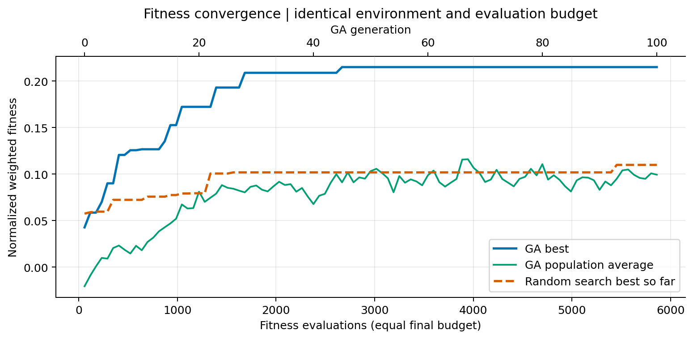
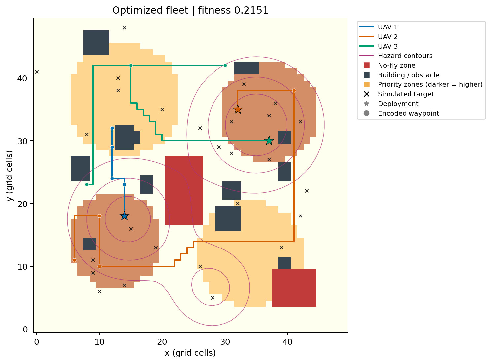
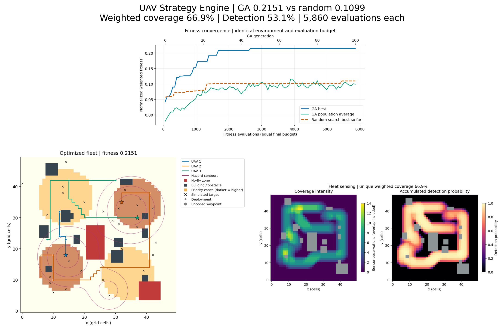

# Multi-Objective UAV Strategy Engine Using Genetic Algorithms

A complete university Artificial Intelligence assignment: a hand-written genetic algorithm evolves a fleet mission over a reproducible disaster grid. The repository includes runnable Python code, deterministic tests, actual numerical results, six generated figures, multi-seed experiments and a four-page technical report.

## Problem and features

Three configurable UAVs survey a 50×50 grid containing priority zones, hazards, buildings, restricted airspace and simulated targets. The strategy balances unique priority-weighted coverage, expected detection, battery expenditure, fleet completion time and hazard exposure.

- Hybrid chromosome evolves deployment, waypoints, speeds, binary sensor states and discrete power.
- Hazard-aware four-neighbour A* expands **every** segment into physically connected cells.
- Coordinate, connectivity, speed, range and battery constraints are repaired and independently checked.
- Tournament selection, two crossover operators, spatial mutation, elitism, random immigrants and optional early stopping.
- Separate random search uses the **same environment, initialization, repair, evaluator and number of fitness evaluations**.
- Saved JSON, CSV and NPZ files support inspection; plots use recorded optimizer histories.
- No prebuilt GA library, GPU, online service or external dataset is required. Matplotlib uses a headless backend.

## Installation

Use Python **3.11 or newer**. From the repository root on Linux/macOS:

```bash
python3 -m venv .venv
source .venv/bin/activate
python3 -m pip install -r requirements.txt
```

On Windows, use `py -3 -m venv .venv`, activate with `.venv\Scripts\activate`, and substitute `python` for `python3`. NumPy, Matplotlib, pytest and ReportLab are the only direct dependencies. Pandas is unnecessary: the standard library writes CSV files. `requirements-tested.txt` records the versions used for the submitted results; the broader ranges in `requirements.txt` support other Python versions.

## Execute

```bash
python3 main.py
python3 main.py --population 60 --generations 100 --mutation 0.15
python3 main.py --experiments
python3 generate_report.py
python3 -m pytest -v
python3 validate_submission.py
```

The first two commands are equivalent. Run the normal simulation and experiments **before** generating the report. The report generator requires measured inputs and does not substitute example results. Every command can be run from another directory using its absolute script path; default output paths remain relative to the repository.

Useful options:

```bash
# Quick demonstration in a separate output directory; preserve submitted results
python3 main.py --population 12 --generations 5 --output /tmp/uav-demo

# Configurable fleet, grid and optional stagnation termination
python3 main.py --uavs 4 --waypoints 5 --size 50 --patience 30 --output /tmp/uav-four

# Explicit experiment settings used for the submission
python3 main.py --experiments --experiment-budget 600 --comparison-budget 1800 --experiment-seeds 42 43 44

# Generate a report from another complete result directory
python3 generate_report.py --output outputs --destination report/Technical_Report.pdf
python3 main.py --help
```

Default algorithm configuration: population 60, 100 generations after initialization, crossover 0.85, mutation 0.15 per gene, tournament size 3, two elites, 5% immigrants, optimizer seed 42 and environment seed 2026. The seed of the optimizer never changes the terrain seed. Set `--crossover`, `--tournament`, `--elites`, `--seed` or `--environment-seed` explicitly as needed. Early stopping is disabled by default. Existing files in the selected output directory are overwritten; use `--output` for separate runs.

## Simulation and chromosome

Arrays use `[y, x]`; coordinates use `(x, y)`. Every traversable cell has priority 1, 3 or 5, hazard in [0,1], a target probability and coverage state. The seeded environment samples 28 target locations from a normalized priority-biased prior. Detection fitness uses the **prior**, not privileged ground-truth target locations; a separate expected-detections diagnostic is evaluated at the sampled targets.

Each UAV has an ID and uses the configurable physical specifications in `UAVConfig`: battery 65 model units, range 90 cells, speed 0.8–3.0 cells/second, base sensor radius 2.6 cells and sensor draw 0.22 × power units/second. Deployment is external to the simulated mission. These are abstract, transparent simulation parameters, not calibrated real aircraft specifications.

```python
Chromosome(plans=[
    UAVPlan(
        uid=0,
        start=(x, y),
        waypoints=[(x1, y1), (x2, y2), (x3, y3), (x4, y4)],
        speeds=[v1, v2, v3, v4],
        sensors=[1, 0, 1, 1],
        sensor_power=[0.5, 1.0, 1.5, 1.0],
    ),
    # Additional UAVPlan objects form the complete fleet mission.
])
```

This example is conceptual; it does not supply hardcoded optimized routes. Start coordinates and waypoints are integers, speeds are real, sensors are binary and power takes values {0.5, 1.0, 1.5}. Four segment arrays have identical length. `Chromosome` supports random initialization, deep copying, structural validation, mutation, crossover, repair and evaluation.

## Fitness and physical model

The engine maximizes the scalarized multi-objective score:

```text
F = 0.35 C + 0.25 D - 0.15 En - 0.10 Tn - 0.15 Rn - P
```

All five metrics are normalized to [0,1] for feasible missions, using fixed physical bounds rather than population statistics. Priorities and service objectives receive 60% of weight; resource costs and risk receive 40%. These weights are declared policy preferences. This implementation returns a weighted compromise and does not compute a Pareto front.

| Symbol | Exact definition |
|---|---|
| `S`, `q[c]` | Traversable cells and their priorities |
| `b[c]` | 1 if at least one active sensor footprint observes cell c; otherwise 0 |
| `C` | `sum(q[c] * b[c]) / sum(q[c])`, over S; repeated visits do not increase unique coverage |
| `pi[c]` | Normalized prior probability that a target is in cell c |
| `z[c]` | Accumulated sensor exposure, defined below |
| `D` | `sum(pi[c] * (1 - exp(-z[c])))`; expected probability of detecting a target drawn from the prior |
| `Ei` | Total energy of UAV i: segment sum `L * (0.26 + 0.045*v**2 + 0.22*s*p/v)` |
| `Ti` | UAV i time: segment sum `L/v`; fleet completion time is `max(Ti)` |
| `Ri` | UAV i integrated risk: `sum(h[arrival_cell]/v)` along actual A* traversals |
| `En` | Fleet energy `sum(Ei)/(N*B)` |
| `Tn` | `max(Ti)/(Lmax/vmin)` |
| `Rn` | Fleet risk `sum(Ri)/(N*Lmax/vmin)` |
| `P` | Zero if feasible; invalid candidates instead receive `F = -1 - V`, for V recorded violations |

Here `N` is UAV count, `B` battery capacity per UAV, `Lmax` maximum range, `vmin` minimum speed, `L` the **expanded A*** segment length, `v` speed, `s` sensor state, `p` sensor power and `h` local hazard. The fleet sums energy and risk while taking the maximum individual flight time. Energy units are model units; risk units are hazard-seconds.

At each arrival cell `a` on a moving active segment:

```text
dt = 1/v
r = sensor_radius * sqrt(p)
z[c] += 0.65*p*dt*exp(-distance(a,c)**2/(2*r*r))*(1 - 0.4*h[c])
```

Only traversable cells within radius r receive exposure. Coverage is binary over the union of these footprints. Detection saturates under repeated observations through `1-exp(-z)`. Higher power increases radius, detection and energy consumption. Speed increases propulsion cost, reduces flight time and decreases sensing dwell and risk exposure. Stationary segments earn no free sensing or coverage. The footprint model excludes occlusion; it can sense traversable ground across an intervening building.

### Hard constraints and repair

Hard constraints are distinct from weighted energy/time/risk objectives: a high score can never authorize blocked or disconnected flight, out-of-bounds coordinates, excessive range/battery usage or invalid speed. Repair:

1. Projects deployments onto valid cells and waypoints onto valid cells in the deployment's connected component.
2. Clamps speed and snaps sensor powers to legal discrete levels.
3. Expands routes with A*, using edge cost `1 + 1.8*(h[a]+h[b])/2`.
4. Shortens overlong/overbudget segments; replans the new endpoint and rechecks its actual resource use.
5. Keeps the chromosome shape intact, allowing stationary suffixes when resources are exhausted.

The evaluator independently checks the resulting mission and records violations. Unreachable un-repaired routes are explicitly infeasible. Visualization rejects infeasible results. There is no straight-line fallback through restricted cells.

## Genetic algorithm

1. Initialize valid repaired random fleet chromosomes and evaluate the population.
2. Select parents using configurable tournaments sampled without replacement.
3. With crossover probability, choose linked **segment swapping** or **geometric/arithmetic** recombination with equal probability. Linked swapping copies waypoint/speed/sensing/power suffixes. Geometric crossover interpolates coordinates and speeds while inheriting discrete genes.
4. Mutate nearby waypoints, occasionally replace a waypoint, perturb speed, toggle sensors, change power or shift deployment. Mutations operate on copies and are followed by repair.
5. Preserve elite survivors and fill the remaining population with evaluated offspring and random immigrants.
6. Track best/average fitness, feasible fraction and diversity. Diversity is mean gene standard deviation after normalizing coordinate, speed, sensor and power genes to comparable ranges.
7. Increase immigrant rate to 15% if diversity falls below 0.06. Stop at the generation/evaluation limit or configured stagnation duration.

Elitism protects the best solutions; mutation and immigrants restore variation. Each generated candidate consumes one fitness evaluation, including immigrants and duplicated genotypes. A* routes are cached, but fitness calls are not memoized. Elite reuse consumes no additional evaluation. Therefore the default budget is `60 + 100*(60-2) = 5,860`, and random search receives exactly 5,860 calls.

## Measured main-run comparison

Actual executed configuration: default 50×50 environment, three UAVs, environment seed 2026, optimizer seed 42, independent baseline seed 10042. Both optimizers used **5,860 fitness evaluations**.

| Metric | GA | Random search |
|---|---:|---:|
| Best fitness | 0.215127 | 0.109895 |
| Priority-weighted unique coverage | 66.88% | 43.40% |
| Prior-weighted detection probability | 53.11% | 32.09% |
| Fleet energy (model units) | 117.807 | 87.090 |
| Fleet completion time (seconds) | 54.002 | 52.596 |
| Hazard exposure (hazard-seconds) | 29.446 | 19.075 |
| Feasible evaluated candidates after repair | 5,860 / 5,860 | 5,860 / 5,860 |

GA best fitness increased from **0.042703** at generation 0 to **0.215127** at generation 100. Its higher coverage and detection outweigh higher absolute resource use under the stated weights. These are computed results for the submitted seeds, not promised values for arbitrary settings. Exact metrics and per-UAV resource totals are in `outputs/results/run_summary.json` and the solution JSON files.

## Sensitivity experiments and fair comparison

`python3 main.py --experiments` runs all requested configurations:

| Factor | Values | Held constant |
|---|---|---|
| Population | 20, 40, 60, 100 | mutation 0.15, tournament 3 |
| Mutation | 0.05, 0.10, 0.15, 0.30 | population 60, tournament 3 |
| Tournament | 2, 3, 5, 7 | population 60, mutation 0.15 |

Each setting uses **three optimizer seeds (42, 43, 44)**, the same environment and exactly **600 fitness evaluations**, including initialization: 36 sensitivity runs. Partial final generations ensure equal budgets; previous survivors fill unevaluated slots to preserve the configured population size for diversity measurements. Equal evaluations mean larger populations receive fewer generations. The modest budget keeps the complete sweep practical; it does not imply all settings have converged. The command also runs **three independent paired GA/random-search comparisons at 1,800 evaluations per optimizer** (six additional optimizer runs). These shorter comparison runs are distinct from the 5,860-evaluation main demonstration.

`sensitivity.csv` records final fitness, coverage, detection, energy, time, risk, diversity, feasibility, runtime, number of generations and evaluation count to achieve 90% of that run's observed improvement. This convergence measure is relative to each run's own gain, not a universal quality threshold. `sensitivity_histories.csv` retains every checkpoint. Error bars show **sample SD**, not confidence intervals. Main and repeated comparisons keep evaluation budgets equal; wall time can differ because GA offspring reuse A* cache entries more often. One shared terrain and three seeds support exploratory conclusions, not a significance claim or generalization to all disaster scenarios.

Wall times were measured on a shared host, with some independent jobs running concurrently. They describe computational cost in this execution, rather than isolated hardware benchmarks. Fitness results and evaluation budgets are independent of those scheduling effects.

## Generated plots and output previews

All PNGs are saved automatically in `outputs/figures/`:

| File | Meaning |
|---|---|
| `fitness_convergence.png` | Actual GA best and population mean, random-search best-so-far, shared evaluation axis and GA generation axis |
| `optimized_flight_paths.png` | Connected A* flight paths, starts, waypoints, target locations, priorities, hazards, no-fly areas and buildings |
| `coverage_heatmap.png` | Observation counts and accumulated detection probability, with colorbars; blocked cells are masked |
| `evolution_across_generations.png` | Best missions at generations 0, 10, 25, 50 and 100; checkpoints adapt to shorter runs |
| `ga_vs_random_search.png` | Final routes and sensing footprints under equal evaluation budgets |
| `hyperparameter_sensitivity.png` | All factors: final fitness, convergence effort, diversity, runtime and feasibility; mean ± sample SD |







Numerical artifacts include `environment.npz` (cell fields and final coverage), `ga_coverage.npz` and `random_coverage.npz` (observation and detection maps), solution JSONs (full chromosomes, expanded paths and per-UAV metrics), `evolution_snapshots.json` (all plotted generation strategies), convergence CSVs, `main_comparison.csv`, `paired_comparison.csv`, per-seed comparison histories and `experiment_summary.json`. `run_summary.json` records all configurations and package versions. `validation.json` records independent artifact checks. `pytest_results.txt` contains the executed verbose test output. The PDF is `report/Technical_Report.pdf`.

## Project architecture

[PROJECT_STRUCTURE.txt](PROJECT_STRUCTURE.txt) contains the complete submission file tree, including every generated result and screenshot.

```text
.
├── README.md
├── PROJECT_STRUCTURE.txt
├── requirements.txt
├── requirements-tested.txt
├── .gitignore
├── config.py
├── main.py
├── generate_report.py
├── validate_submission.py
├── src/
│   ├── __init__.py
│   ├── environment.py
│   ├── drone.py
│   ├── chromosome.py
│   ├── pathfinding.py
│   ├── constraints.py
│   ├── fitness.py
│   ├── selection.py
│   ├── crossover.py
│   ├── mutation.py
│   ├── genetic_algorithm.py
│   ├── random_search.py
│   ├── experiments.py
│   ├── visualization.py
│   └── io_utils.py
├── tests/
│   ├── conftest.py
│   ├── test_chromosome.py
│   ├── test_constraints.py
│   ├── test_fitness.py
│   └── test_genetic_algorithm.py
├── outputs/
│   ├── figures/       # Six required figures
│   ├── results/       # Actual numerical measurements and validation
│   └── screenshots/   # Output dashboard and report preview
└── report/
    └── Technical_Report.pdf
```

The original assignment `.docx` is retained in the workspace. `config.py` owns immutable configuration; environment/pathfinding own geometry; chromosome/operators own genes; the evaluator is the single source of objective and feasibility calculations; both optimizers use it; experiments, plotting and reporting consume measured data.

## Testing and artifact validation

```bash
python3 -m pytest -v
python3 validate_submission.py
```

The deterministic tests cover valid initialization, bounds, deep copies, both crossovers, mutation, independent fitness mathematics, unique coverage, sensor activation/power, speed, energy, fleet time, obstacle avoidance, hazard-aware detours, unreachable routes, deployment repair, battery/range enforcement, reproducibility, early stopping and exact GA/random-search budgets. `validate_submission.py` independently reconstructs saved missions, checks expanded paths/resources and metric consistency, verifies convergence and budgets, checks experiment completeness, verifies required PNGs and checks the report. If Poppler utilities are installed it also checks the PDF has four pages and the required section text. They are available in the submission environment; the simulator itself does not require them.

Submitted test output and validation evidence are saved under `outputs/results/`. Tests use small analytic scenarios and do not rerun expensive sweeps.

## Technical report

`python3 generate_report.py` produces `report/Technical_Report.pdf` with four explicit pages: introduction/problem formulation, methodology and mathematical model, results/experiments, and discussion/conclusion. Tables and plotted results come from the current output files. Environment mismatches are rejected. Use the personalized Word report for review and final PDF export. The source is intentionally included so results and PDF can be regenerated together.

## Student details

Name: Mian Abd ur Rahman Qayyum  
Roll number: 03-134242-039  
University: Bahria University, Lahore Campus  
Department: Computer Science  
Course: Artificial Intelligence — BSCS 5, Assignment 2

The personalized editable report is [Technical_Report_Mian_Abd_ur_Rahman_Qayyum.docx](report/Technical_Report_Mian_Abd_ur_Rahman_Qayyum.docx), and the exported report is [Technical_Report_Mian_Abd_ur_Rahman_Qayyum.pdf](report/Technical_Report_Mian_Abd_ur_Rahman_Qayyum.pdf). Report screenshots show an earlier draft. The assignment brief specifies a team of three; this repository lists the supplied individual author.

## Limitations and extensions

The terrain and hazards remain static during each mission. Flights are one-way from freely chosen deployment cells with no launch cost or return-to-base reserve. Four-neighbour paths omit continuous dynamics, altitude, acceleration and turning radii. The model does not enforce UAV separation or communication constraints. Sensors use an independent-exposure disk model with no occlusion. Energy is a surrogate model. Repair can produce stationary suffixes. Experiments vary optimizer seeds on one terrain; weights are fixed, not a Pareto optimizer. Future work can add dynamic hazards, collision avoidance, realistic power calibration, return routes, multiple terrain seeds and Pareto-based selection.

## GitHub submission

Source code, tests, measured outputs, plots, report drafts and the personalized Word report are included. The local virtual environment, caches, credentials and temporary files are excluded.

Before submitting, review the personalized PDF and add your published repository link to the report if required.
